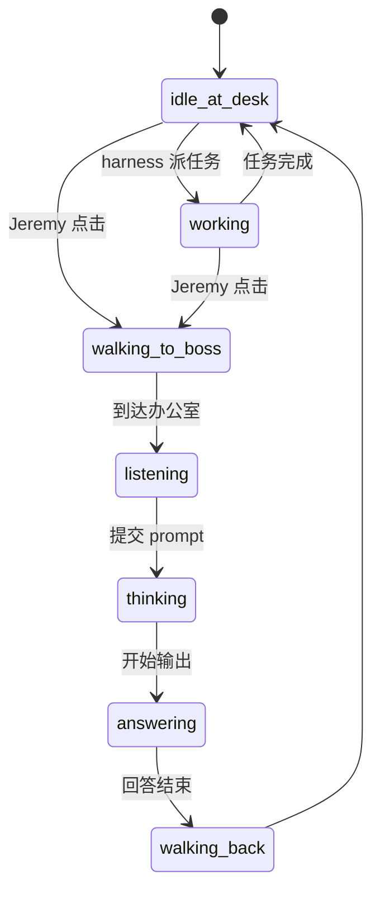
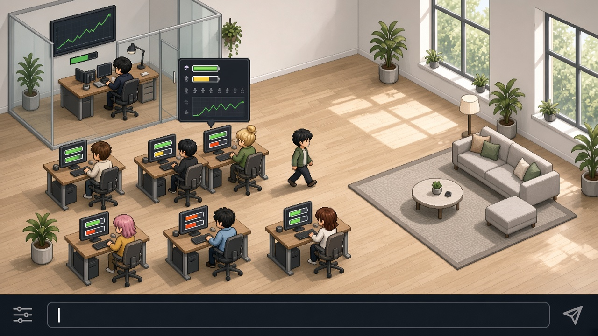
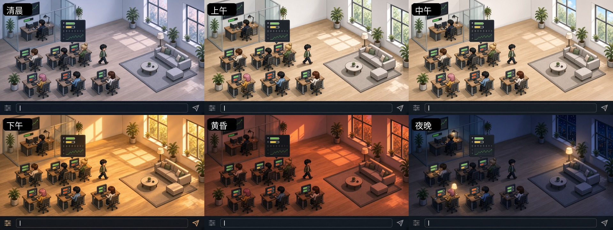

# AgentDesk 像素办公室 · 设计文档 v0

> 整理日期：2026-10-29　｜　设计讨论：Jeremy × Design
> 本文件夹只放设计产出（文档 + 概念图），不包含代码，也没有改动 AgentDesk 的任何源文件。

## 1. 目标

把本地多 agent harness 可视化成一个动画像素办公室：
- 每个 agent 有自己的工位，平时在工位工作或待机。
- 点击某个 agent，它会走进 Jeremy 的办公室；Jeremy 在底部输入 prompt；agent 回答后走回自己的工位。
- Jeremy 办公室墙上的大屏显示他的信息，比如 IBKR/MCP 股票收益、额度剩余等。

灵感来源：[dallastesla 的 X 帖子](https://x.com/dallastesla/status/2115536116162216197)。
注意，原视频是 3D 等距低多边形风格，不是像素风。我们只借鉴交互思路，美术方向自己做。

## 2. 已定决策

| 项目 | 决定 |
|---|---|
| 运行形态 | 桌面应用 |
| 技术路线（暂定） | 先按网页开发，再用 **Tauri** 打包；渲染用 **PixiJS**；harness 和前端之间用 **WebSocket 事件流** |
| 美术方向 | **D：现代北欧极简像素工作室**，浅橡木地板、白墙、大窗、绿植、玻璃隔断老板房 |
| 工位信息 | 每台工位显示器上放两条小仪表：额度剩余 + 上下文占用 |
| 昼夜 | 按 Jeremy 的本地时区渲染六个时段的光照 |

### 为什么选 Tauri + PixiJS
- 桌面应用可以常驻小窗或置顶，能直接访问本地 harness 的端口和文件，还能发系统通知（比如某个 agent 需要你处理）。
- 先当网页写，调试和热更新最快；Tauri 的包比 Electron 小很多（约 10MB 对比约 150MB），Rust 后端正好用来桥接 harness。
- PixiJS 是 WebGL 2D 渲染库，适合精灵动画、滤镜和调色，比 Phaser 更轻，不需要完整的游戏引擎。

## 3. 场景布局（基于 D / D2）

- **左上：Jeremy 的办公室**，玻璃隔断。墙上大屏显示股票收益折线和电池式额度条。
- **中部：6 个 agent 工位**，每个工位配一个外观不同的小人。
- **右侧：休息区**，沙发加地毯，以后可以用来表示 agent 空闲，或者两个 agent 在协作。
- **底部：深色 prompt 输入栏**，固定在画面底部。
- 镜头：俯视 3/4 视角，固定，一屏放下整个办公室。

## 4. 工位仪表（额度 + 上下文）

- 仪表直接显示在工位显示器上（D2 的做法），一眼就能看到，画面也干净。
- **上条：额度剩余**，电池样式。充足时绿色，中等时黄色，偏低时红色。
- **下条：上下文占用**，填充条。接近上限时变橙红并闪烁。
- 平时只显示条；鼠标悬停或点击 agent 时弹出详情卡片，显示具体数字和一条小趋势线。
- 待定：要不要另做桌边小立牌，或者把上下文条做成"水位"效果。

## 5. 昼夜循环（跟随本地时区）

| 时段 | 光照 |
|---|---|
| 清晨 | 冷调蓝灰粉，窗外淡粉 |
| 上午 | 明亮清爽，偏冷一点（要和中午拉开差距） |
| 中午 | 最亮，中性白，阴影最短 |
| 下午 | 暖金色，地板上有长光束和窗影 |
| 黄昏 | 橙红深暖光 |
| 夜晚 | 深海军蓝，窗外星空和城市灯火；台灯和显示器发光，桌上多一杯咖啡 |

实现方式：一张底图，叠按时段变化的调色滤镜和光斑层；时段之间平滑渐变；夜晚额外打开灯光和发光层。
已知问题：概念图里上午和中午几乎一样，实现时要单独调亮度和色温。
可选彩蛋：午饭时间休息区人多一些，夜里桌上出现咖啡。

## 6. 角色状态机（初稿）



- `thinking` / `answering`：头顶出现气泡，回答以流式显示。
- 可扩展的状态：`needs_you`（需要你处理）、`error`（出错）、`coordinating`（和别的 agent 协作，走去休息区或对方工位）。

## 7. harness 事件接口（草案）

前端只负责演出，不碰业务逻辑。harness 通过 WebSocket 推事件：

```jsonc
// agent 状态变化
{ "type": "agent.status", "agentId": "coder", "status": "working", "task": "..." }

// agent 输出（流式）
{ "type": "agent.message", "agentId": "coder", "delta": "...", "done": false }

// 每个 agent 的额度和上下文
{ "type": "agent.usage", "agentId": "coder",
  "quota": { "remaining": 0.62 },
  "context": { "used": 84000, "limit": 200000 } }

// 墙上大屏数据
{ "type": "metrics.update", "pnl": { "value": 81.79, "changePct": 4.0 }, "quotaRemaining": 0.7 }
```

前端发给 harness：

```jsonc
{ "type": "prompt.submit", "agentId": "coder", "text": "..." }
```

## 8. 下一步

- [ ] 确认 agent 名单、角色和每个人的颜色/外观
- [ ] 定墙上大屏的具体内容和数据来源（IBKR/MCP、额度）
- [ ] 细化点击 → 走路 → 对话 → 回工位的交互细节和寻路方式
- [ ] 定像素规格（瓦片尺寸、角色尺寸、动画帧数）
- [ ] 查清每个 provider 的额度和上下文数据能不能拿到、怎么拿
- [ ] 做一个可交互的原型

## 9. 图片索引（`images/`）

| 文件 | 内容 |
|---|---|
| `A.jpg` `B.jpg` `C.jpg` | 第一轮：轨道空间站、树屋工作室、雨夜港口夜市（嫌不够现代，弃用） |
| `D.jpg` | 第二轮：北欧极简工作室（**选定**） |
| `E.jpg` `F.jpg` | 第二轮：深色科技总部、屋顶 loft |
| `D2.jpg` | D 加上工位额度和上下文仪表，以及悬停详情卡片 |
| `D2-dawn/morning/noon/afternoon/dusk/night.jpg` | 六个时段的光照 |
| `D2-daycycle.jpg` | 六时段 3×2 对比图 |



